# Chapters

**Your trips, already a book.** Chapters turns a traveler's camera roll into a ready-to-order
photobook automatically, and nudges them at the perfect moment, right when they get home.

Built with **Expo / React Native + TypeScript**. A warm, editorial, photo-forward design in the
spirit of a premium photobook brand: cream surfaces, a terracotta accent, sage support, and a
Fraunces serif paired with Inter.

## Demo

| iOS | Android |
|---|---|
| 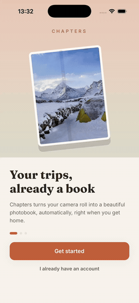 | 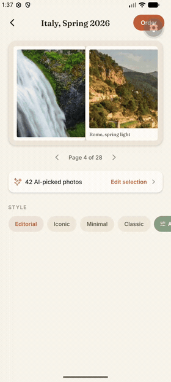 |

Same Expo / React Native codebase running on both platforms.

## What it shows

Chapters removes the #1 friction point of making a travel photobook: getting started. The app
watches (with consent) for the end of a trip, auto-curates the best shots, lays them out in a
recommended theme, and delivers a finished draft as a "welcome home" moment.

- **Zero-friction onboarding** - photo + location access framed as a personal travel assistant,
  not tracking.
- **Auto-generated draft books** - one per trip, each a cover card with dates, place, photo count
  and a Draft / Ordered status.
- **Welcome-home trigger** - a location-detected arrival screen: "Welcome home from Italy, we
  picked your 42 best photos and laid out a draft book."
- **Editorial book preview** - a swipeable two-page spread viewer with a theme chip row.
- **AI theme picker** - Editorial / Iconic / Minimal / Classic, with a rationale for the
  recommended style ("your trip has lots of wide scenery").
- **Photo curation** - a camera-roll grid with AI best-shots pre-starred; tap to include/exclude.
- **Book customization** - editable cover title, page stepper, cover finish, size, and an
  extra-pages upsell.
- **Checkout** - format + size, a live price breakdown, address, and order placement.
- **Alerts** - location-triggered reminders and trip-completion notifications.
- **Profile** - permission toggles, orders, and travel stats.

## Screens

| | | |
|---|---|---|
| 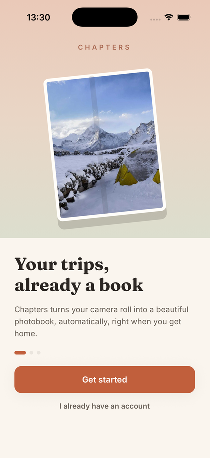 | 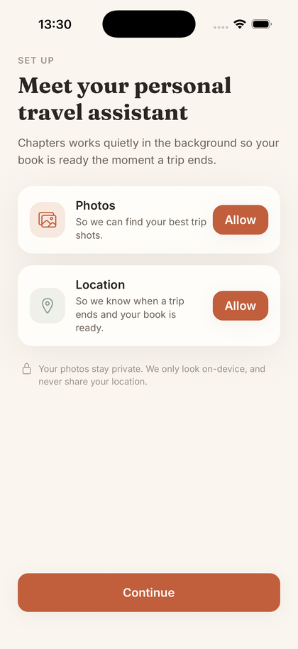 | 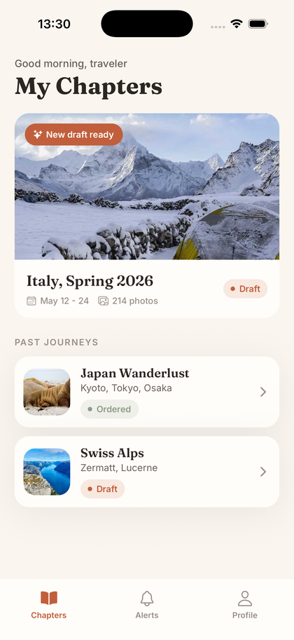 |
| Onboarding | Permissions | My Chapters |
| 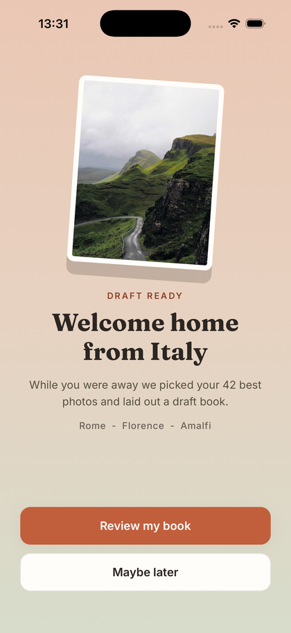 | 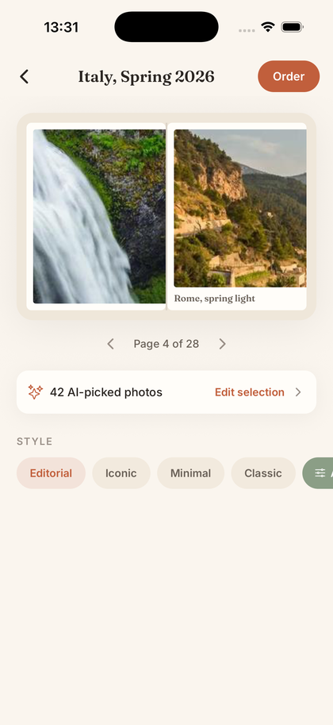 | 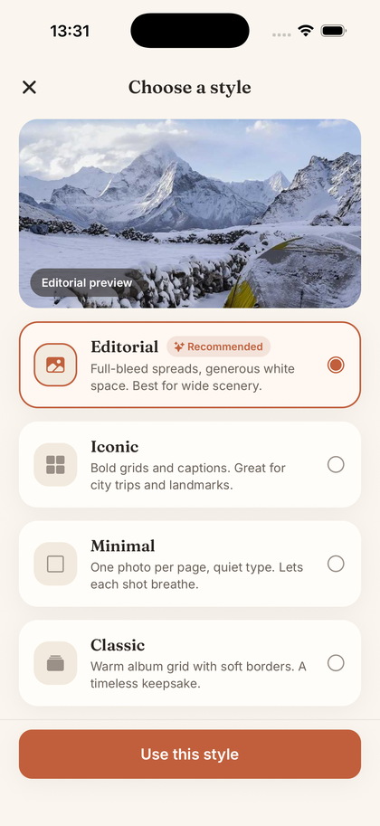 |
| Welcome home | Book preview | Theme picker |
| 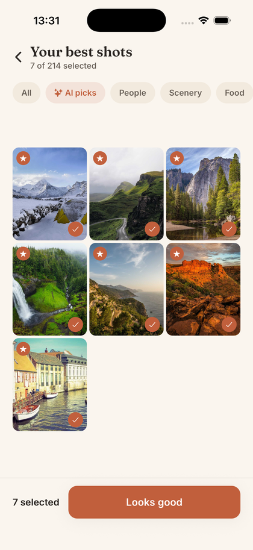 | 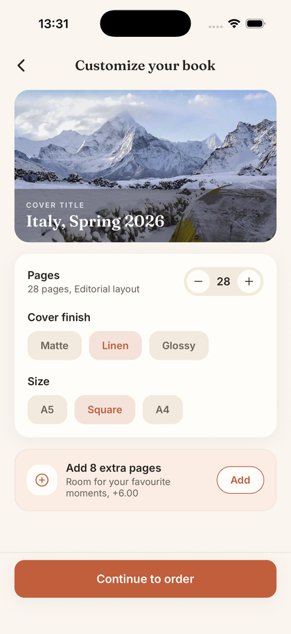 | 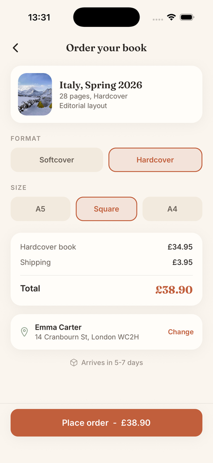 |
| Photo curation | Customize | Checkout |
| 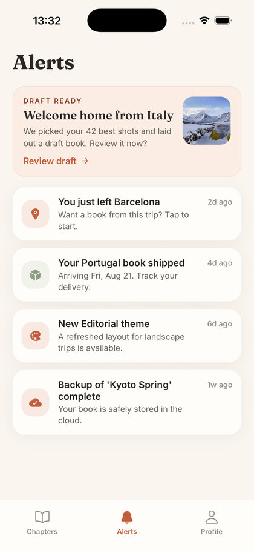 | 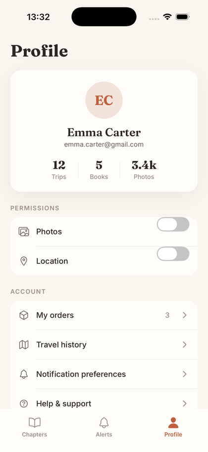 | 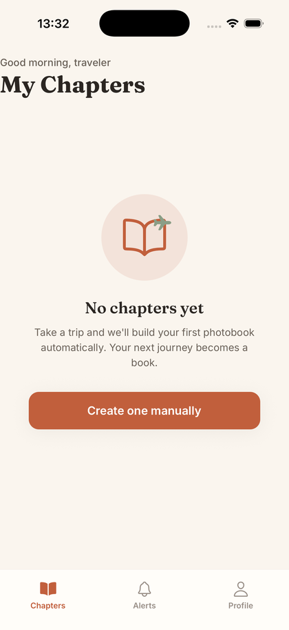 |
| Alerts | Profile | Empty state |

## App flow

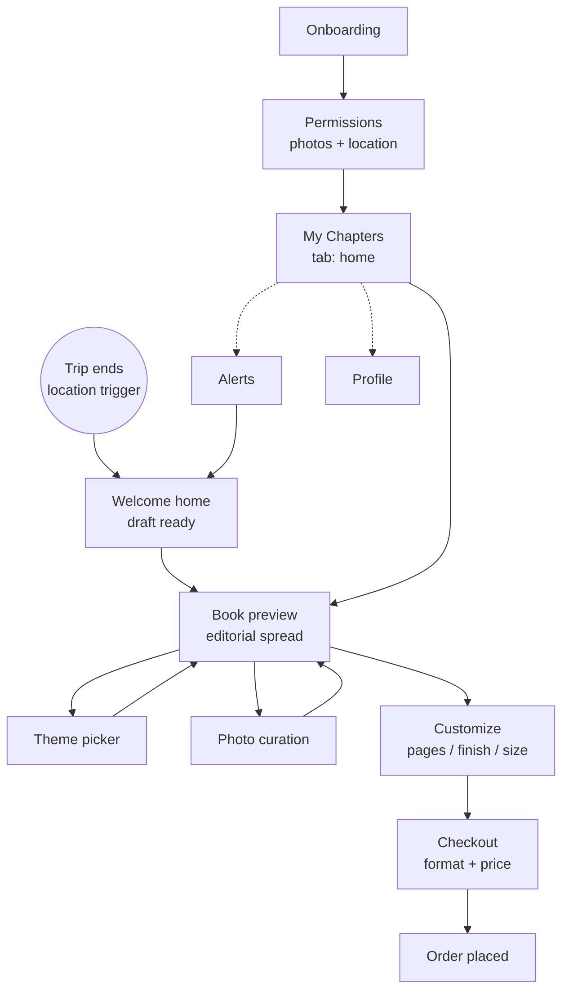

## Architecture

Managed Expo app, file-based routing, one small global store.

- **Expo Router** - typed file-based routes under `app/`. A `(tabs)` group holds the three-tab
  shell (Chapters / Alerts / Profile); detail screens (preview, theme, curation, customize,
  checkout, welcome-home) are pushed on top. Every screen is deep-linkable
  (`chapters:///preview?id=italy`).
- **Zustand** (`src/store.ts`) - permission grants, per-trip draft state (theme, page count,
  extra-pages, excluded photos, cover title) and placed orders. Optimistic and synchronous.
- **Design tokens** (`src/theme.ts`) - colors, radius, shadow, and the Fraunces + Inter type
  scale, mirrored from the Stitch design system in `design/DESIGN.md`.
- **Mock data** (`src/data.ts`) - trips, themes, alerts, and the user, with bundled travel
  photos (`src/photos.ts`) so the app is fully offline and demoable on a simulator.
- **Fonts** - Fraunces (display) + Inter (body) loaded via `@expo-google-fonts` in
  `app/_layout.tsx`; nothing renders until they are ready.

```
app/
  _layout.tsx            root stack + fonts
  index.tsx              onboarding
  permissions.tsx        photo + location grant
  (tabs)/
    _layout.tsx          Chapters / Alerts / Profile tab bar
    index.tsx            My Chapters (+ empty state)
    alerts.tsx           notifications
    profile.tsx          settings + stats
  welcome-home.tsx       trip-detected hero
  preview.tsx            book spread viewer
  theme.tsx              AI theme picker
  curation.tsx           photo grid
  customize.tsx          book options + upsell
  checkout.tsx           order
src/
  theme.ts  photos.ts  data.ts  store.ts  ui.tsx
design/                  source Stitch design (HTML per screen + DESIGN.md + logo)
```

## Run

```sh
npm install
npx expo start
```

Press `i` for iOS or `a` for Android. No camera, location, or backend is required, everything is
mocked so it runs on a bare simulator.
